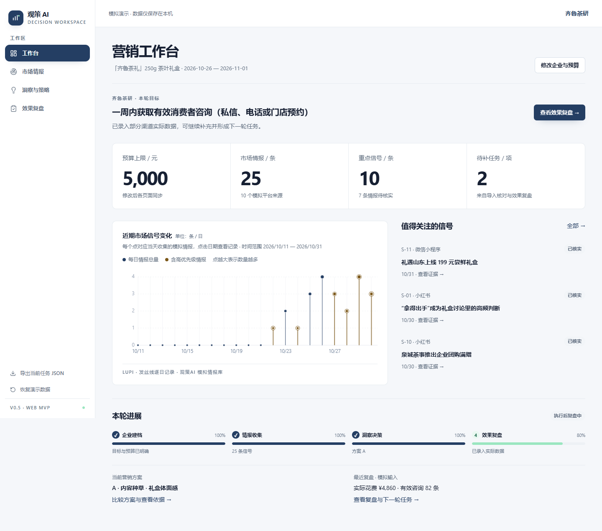

# 观策AI Web MVP v0.5

纯前端的企业营销情报与决策演示工具。沿用 v0.4 的 M1—M5 与 M5→M2 闭环，前台保留工作台、市场情报、洞察与策略、效果复盘四个入口。

企业、平台摘录、消费者主题、候选方案及投放结果均为模拟。洞察为预设分析；用户可编辑和录入数据，输入仅保存在浏览器。没有后端、数据库、真实 AI、爬虫或广告接口。



## 启动

要求 Node.js 22+、npm。首次安装需要联网，安装后核心演示流程无需外部服务，也不加载在线字体。

```bash
npm ci
npm run dev -- --host 127.0.0.1 --port 5174
```

打开终端显示的本地地址。若端口被占用，Vite 会选择下一个端口。

```bash
npm run lint
npm run typecheck
npm test
npm run build
npm run preview -- --host 127.0.0.1
```

静态部署需将所有页面路径回退到 index.html。浏览器持久化受 origin（主机、端口）隔离，旧端口的数据不会自动迁移。

## 本轮变化

- 工作台合并重复预算/审批/方案信息：一条指标带、一个趋势图、三条重点记录和本轮进展。
- 情报清单优先，移除四张 KPI 卡，将时间与来源分布按需展开；保留全部筛选、证据详情、备注、重要性和状态修改、CSV/JSON 导入及反馈任务。
- 策略页直接展示 A/B 比较和编辑，消费者主题、证据质量及竞品机会按需展开。保留方案编辑、预算阻断、按比例调整、人工理由和不可变审批快照。
- 复盘保留四项主要结果、渠道输入和下一轮任务，补充对比图按需展开；所有指标由录入数据重算。
- 统一冷白灰/海军蓝、字体、细线和间距，去除指标渐变及重复顶栏按钮。放大图表标签；小屏图表在自身区域横向滚动。
- 修复零花费成本显示、同一毫秒审批 ID 冲突、无效复盘渠道误报成功。

## 演示操作

1. 工作台修改企业预算，策略页上限与审批状态同步；超过预算时不能确认。
2. 情报页使用筛选，打开记录查看模拟原文，修改优先级/核实状态及人工备注。
3. 策略页选择 A/B，编辑方案与渠道预算。填写理由并确认；快照保留当时方案、预算及证据状态。后续方案、预算、关联证据状态变化会触发复审。
4. 展开消费者主题分析，点击主题及证据返回情报详情。
5. 复盘页录入真实可操作的数值，重新计算 CTR、CPC、咨询成本等。缺失值与零值区分，分母为零时不计算成本。
6. 将下一轮建议加入任务，再前往情报页完成或重开待办。
7. 侧栏导出完整 JSON；恢复演示数据需二次确认。原有 localStorage key 保留为 `guancha-ai-mvp-v04`。

## 复现浏览器验收

先启动本地站点，再运行：

```bash
npm run ui:verify
# 自定义站点：设置 BASE_URL 环境变量后运行
```

脚本使用本机 Chrome。无 Chrome 时：`npx playwright install chromium`，设置 `CI=1` 后运行，使用 Playwright Chromium。检查四页 1440×1000、768×1024、390×844，完成关键操作并保存 `docs/ui-verification.json` 与 `docs/screenshots/`。CI 安装 Chromium 后也会执行浏览器验收。

- [分阶段计划](docs/PLAN-v0.5.md)
- [本轮验收记录](docs/QA-v0.5.md)
- [协作规则](CONTRIBUTING.md)
- [第三方许可](THIRD_PARTY_NOTICES.md)
- [v0.2 审计](docs/AUDIT-v0.2.md)

`docs/demo/` 中视频及 `docs/DEMO-GUIDE.md` 属于原 v0.4 基线，不代表本轮界面；本轮交付以 desktop/tablet/mobile 截图及验收记录为准。

## 开发方式与边界

私有仓库：nianpingy-cpu/guance-ai。首次提交原样导入 v0.4；后续采用 Issue → 分支 → 测试 → PR → 独立审查 → CI → 合并，不直接修改 main。

React 18、TypeScript、Vite、Zustand、Tailwind；数据源为 `src/data/demo.ts` 的统一确定性 mock 对象，纯 JSON 可序列化；计算集中在 `src/lib/calculations.ts`。SVG 图表独立实现，参考 Lieflat 的 Lupi/Glance/Basics，不将参考仓库当作 React 包安装。

localStorage 可由浏览器用户修改，不是可信审计系统；没有真实成效验证或模型运行。全页面监控是本轮实际执行的有限验收，不含后台持续监控。
