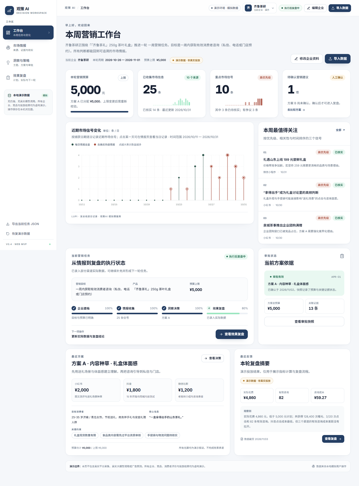

# 观策 AI · Web MVP v0.4

> 让企业看清市场信息，理解营销机会，并作出有依据的行动决策。

一个**纯前端、可独立运行、可重复演示**的 B 端 SaaS 原型。保留 v0.2 的预算校验、人工审批、效果回填与本地持久化业务逻辑，重构为四个一级页面、统一设计系统和 7 个可交互数据图表。

> **演示边界**：齐鲁茶研、竞品、消费者评价、平台来源与投放结果均为虚构或模拟。当前没有后端、真实平台采集、真实大模型调用、真实广告投放或真实数据库。页面内所有相关位置均明确标注“演示数据 / 预设模拟分析”。



## 1. 快速开始

环境：**Node.js 20+**（本机验证：Node `v24.13.0`，npm `11.6.2`），依赖管理器 **npm**。

```bash
npm install
npm run dev
```

打开终端提示的地址（默认 <http://127.0.0.1:5173>）。

生产构建与本地预览：

```bash
npm run build
npm run preview
# http://127.0.0.1:4173
```

> `npm run preview` 使用 Vite 的 SPA fallback；直接刷新 `/strategy` 等路由不会 404。若部署到静态服务器，请配置 history fallback 到 `index.html`。

## 2. 交付内容

| 内容 | 位置 |
|---|---|
| 完整源码 | `src/` |
| 设计 Token / 全局样式 | `src/styles/global.css`、`tailwind.config.js` |
| 四页桌面截图 | `docs/screenshots/dashboard.png`、`signals.png`、`strategy.png`、`review.png` |
| 四页移动端截图 | `docs/screenshots/mobile-*.png` |
| 完整流程录屏（约 43 秒，1440×900） | `docs/demo/guance-ai-demo.mp4` |
| 可复现演示步骤 | `docs/DEMO-GUIDE.md` |
| v0.2 审计与迁移清单 | `docs/AUDIT-v0.2.md` |
| 第三方许可 | `THIRD_PARTY_NOTICES.md` |

录屏覆盖：工作台 → 情报详情与核实 → 审批重新确认 → 复盘数据录入 → 加入下一轮情报任务 → 情报页闭环。录屏无配音，画面底部有步骤说明。

## 3. 技术栈

- Vite 5 + React 18 + TypeScript
- Tailwind CSS 3 + CSS Variables 设计 Token
- React Router 6（四个一级路由）
- Zustand 4（跨页面状态 + `persist`）
- 原生 SVG 图表（无 ECharts / Chart.js）
- Vitest + jsdom（20 个核心逻辑测试）
- Playwright（截图与录屏脚本）

## 4. 四个页面

### 工作台 `/dashboard`

- 四张 Glance 风格 KPI：预算、情报量、重点信号、待确认建议。
- Lupi 风格逐日信号趋势：发丝线、点阵、高优先级外环；点击某日可跳到情报页并筛选。
- 本周三条重点信号：点击自动打开对应情报详情。
- 当前营销任务：目标、产品、预算、四阶段进度、下一项操作。
- 最近方案摘要与最近复盘指标。
- 企业档案抽屉编辑；修改预算会同步更新方案上限与审批状态。

### 市场情报 `/signals`

- 概览 KPI、来源平台排序图、情报时间分布图。
- 关键词、平台、类别、优先级、状态、时间范围、单日筛选；统计与图表随筛选变化。
- 编辑型情报列表；点击打开详情抽屉。
- 详情：原始引用、模拟来源说明、观测事实、分析判断、待核实/冲突信息、人工备注。
- 可修改优先级、处理状态（已核实/待核实/有争议），并联动工作台与审批状态。
- CSV / JSON 导入：字段校验、成功/失败数量、逐行错误提示、导入后自动生成核对任务。
- 下一轮情报任务：打开、定位关联记录、完成/重开。

### 洞察与策略 `/strategy`

- 消费者关注主题排序（Glance）；点击主题显示证据。
- 证据质量结构（已核实/待核实/有争议/重复）。
- 竞品与市场机会卡：观测事实、机会推断、待核实事项分开呈现。
- 关键机会总结：带来源编号，可跳转证据。
- A/B 两套实质不同的方案：内容种草 vs 同城即时礼赠。
- 方案可编辑；预算按渠道编辑，超过企业上限即时拒绝；可“按比例调整至上限”。
- 人工确认理由 + 不可变审批快照（方案副本、预算、证据状态、指纹、时间）。
- 企业预算、方案内容或关键情报变化 → 自动变为“需要重新确认”。
- “暂不投放” + “恢复方案选择”。

### 效果复盘 `/review`

- 已确认方案、计划预算、实际花费、曝光、点击、有效咨询、CTR/CPC/咨询成本。
- 计划与实际分组柱图：花费 / 曝光 / 点击 / 咨询分指标切换；不同单位不混轴。
- 渠道效率小型多图：CTR、CPC、咨询成本三栏独立刻度。
- 实际数据逐渠道录入，图表自动重算；缺失字段显示“暂无数据”，不按 0 处理。
- 复盘结论：观察、计划差异、可能原因（推测）、当前无法确认的判断、复盘备注。
- 原始审批快照查看。
- 下一轮信息建议 → “加入下一轮情报任务” → 情报页出现真实待办。
- 打印 / PDF。

## 5. 跨页面状态链

已实现并测试：

1. 企业预算修改 → 方案上限、预算校验、审批状态同步。
2. 情报优先级/状态修改 → 工作台重点信号、待核实数量、方案审批状态同步。
3. 选择消费者主题 → 显示对应证据，可跳回情报详情。
4. 编辑方案/渠道预算 → 图表、合计、快照依据同步。
5. 确认方案 → 保存审批快照 → 复盘页出现已确认版本。
6. 修改影响审批的依据 → 显示“需要重新确认”，旧快照保留。
7. 录入实际投放数据 → KPI 与图表同步更新。
8. 创建下一轮任务 → 情报页出现待办。
9. 刷新页面 → localStorage 保留数据。
10. 恢复演示数据 → 一键回到可重复演示的初始状态。

## 6. 图表系统

所有图表来自同一套本地数据或确定的计算公式，无随机趋势。统一由 `ChartFrame` 提供标题、单位、时间范围、来源和说明。

| # | 组件 | 视觉语言 | 用途 | 交互 |
|---|---|---|---|---|
| 1 | `SignalTrendChart` | Lupi | 市场信号逐日分布 | Hover 提示、点击日期筛选 |
| 2 | `SourceRankChart` | Glance | 来源平台排序 | Hover、点击平台筛选 |
| 3 | `ThemeRankChart` | Glance | 消费者关注主题排序 | Hover、点击主题看证据 |
| 4 | `EvidenceQualityChart` | Basics | 主题证据质量堆叠 | Hover 分段、点击主题 |
| 5 | `BudgetAllocationChart` | Basics | A/B 渠道预算分配 | Hover 渠道、点击切换方案 |
| 6 | `PlanVsActualChart` | Basics | 计划/实际花费及曝光/点击/咨询 | 指标切换、Hover |
| 7 | `ChannelEfficiencyChart` | Basics | CTR / CPC / 咨询成本小型多图 | Hover、点击渠道聚焦 |

另有 KPI 迷你条形图与趋势线，用于支持大数字阅读，不单独承担结论。

图表无障碍：提供 `role="img"` / `aria-label`，同时用数字、文字、形状与颜色表达状态；支持键盘操作；遵循 `prefers-reduced-motion`。

## 7. 数据访问层与状态

- 逻辑数据访问：`src/data/repository.ts`
  - `localRepository.load()` / `save()` / `clear()` / `reset()`
  - 结构校验 `isAppData()`
  - 当前由 localStorage 实现；未来可替换为异步 API 适配器。
- 统一演示数据：`src/data/demo.ts`
  - 1 个企业、12 个来源、25 条情报、5 个关注主题、3 个机会卡、2 套方案、1 个审批快照、1 份复盘、3 个初始反馈任务。
  - 含待核实、有争议、重复与冲突记录；所有 ID 稳定且相互关联。
- 跨页面状态：`src/store/appStore.ts`（Zustand + persist）
- 计算逻辑：`src/lib/calculations.ts`
  - 预算校验、按比例缩放、复盘指标、渠道指标、证据指纹、审批健康、筛选、趋势、任务阶段。
- 格式化：`src/lib/format.ts`
- 导入解析与校验：`src/lib/importSignals.ts`

持久化 key：`guancha-ai-mvp-v04`。演示时钟下限为 `2026-11-03T09:30+08:00`，确保新审批快照排序在种子数据之后。

## 8. 重置、导出与测试

### 重置演示数据

侧栏底部 → **恢复演示数据** → **确认恢复**。  
会清除当前浏览器里的修改，重新载入完整初始案例。建议先导出 JSON。

### 导出

侧栏底部 → **导出当前任务 JSON**。文件包含企业、来源、情报、主题、方案、审批快照、复盘与反馈任务。

### 测试与检查

```bash
npm run typecheck   # TypeScript 类型检查
npm test            # 20 个 Vitest 用例
npm run build       # 类型检查 + 生产构建
```

测试覆盖：

- 预算上限校验、超限拒绝、按比例缩放。
- 金额解析、缺失值与零值处理。
- 复盘指标与渠道指标计算。
- 审批指纹、证据变化/预算变化/方案编辑导致重新确认。
- 确认方案后状态恢复有效。
- 新增复盘数据、非法值拒绝。
- 反馈任务去重。
- CSV 引号解析、CSV/JSON 导入成功/失败计数、行级错误。

浏览器实操检查（Chrome，1440 与 390 宽）：

- 四个页面无横向溢出；控制台无 pageerror / console error。
- 情报筛选、详情、备注、状态修改。
- 预算修改、超限提示、按比例调整、确认快照。
- 复盘数据录入与刷新持久化。
- 下一轮任务创建并在情报页出现。
- 移动端导航、抽屉和表格横向滚动。

## 9. 目录结构

```text
src/
  components/
    layout/     AppShell、Sidebar、Topbar、PageHeader、ErrorBoundary
    ui/         Button、Card、Tag、MetricCard、Overlay、Form、Progress、Toast
    charts/     ChartFrame、7 个图表组件、Spark、主题色
  pages/        DashboardPage、SignalsPage、StrategyPage、ReviewPage
  features/
    company/    CompanyDrawer
    signals/    ImportModal
    strategy/   （共享逻辑在页面与 lib 中）
    review/     （共享逻辑在页面与 store 中）
  data/         demo.ts、repository.ts
  store/        appStore.ts、ui.ts、toast.ts
  lib/          calculations.ts、format.ts、importSignals.ts、测试
  types/        domain.ts
  styles/       global.css
docs/
  screenshots/  桌面与移动端截图
  demo/         流程录屏
  AUDIT-v0.2.md
  DEMO-GUIDE.md
scripts/
  screenshots.mjs
  record-demo.mjs
```

## 10. v0.2 审计结论

详见 [`docs/AUDIT-v0.2.md`](docs/AUDIT-v0.2.md)。摘要：

- **保留并重构**：企业档案、预算分单位、预算上限、审批快照、变更失效、渠道结果、反馈任务、本地持久化、导入校验。
- **替换**：五步单页与 M1–M5 编号 → 四页业务导航；原生 DOM → React；整包 JSON 恢复 → 一键恢复演示数据 + JSON 导出；渠道报表 CSV → 情报 CSV/JSON。
- **移除**：规则预算草案（避免在无真实历史时制造伪预测）、本地审计日志、原生单文件渲染。

## 11. 暂未实现 / 明确边界

- 无后端、无登录、无多租户、无企业切换（首版只有一个演示企业）。
- 不连接真实小红书/抖音/美团/点评/电商平台，不做实时爬虫。
- 不接入真实大模型；“洞察”和“AI 建议”位置均标注为预设模拟分析。
- 不预测 CTR、转化率、ROAS 或增量效果；不复刻广告平台报表。
- 无真实成交、退款、归因数据，因此在复盘页不计算 ROAS，不把相关性写成因果。
- localStorage 不是可信审计存储，浏览器用户可修改。
- Lieflat Charts 参考仓库为 PolyForm Noncommercial License 1.0.0；本项目为非商业演示，未打包其代码，详见 `THIRD_PARTY_NOTICES.md`。

## 12. 复现截图与录屏

先启动预览服务：

```bash
npm run preview
```

另开终端：

```bash
npm run screenshots   # 写入 docs/screenshots/
npm run demo:record   # 写入 docs/demo/guance-ai-demo.webm
```

脚本默认使用本机 Chrome（`channel: chrome`）。若环境没有 Chrome，可执行 `npx playwright install chromium` 后把脚本中的 channel 改为默认 chromium；录屏还需 `npx playwright install ffmpeg`。

`demo:record` 使用 Playwright 录制完整业务流程并输出 `.webm`。仓库内已提供转换后的 `docs/demo/guance-ai-demo.mp4`，便于直接播放。

## 13. 第三方许可

见 [`THIRD_PARTY_NOTICES.md`](THIRD_PARTY_NOTICES.md)。本项目自身代码为比赛/课程展示用途；如用于商业场景，请先重新核查 Lieflat Charts 参考许可与所有演示素材。
